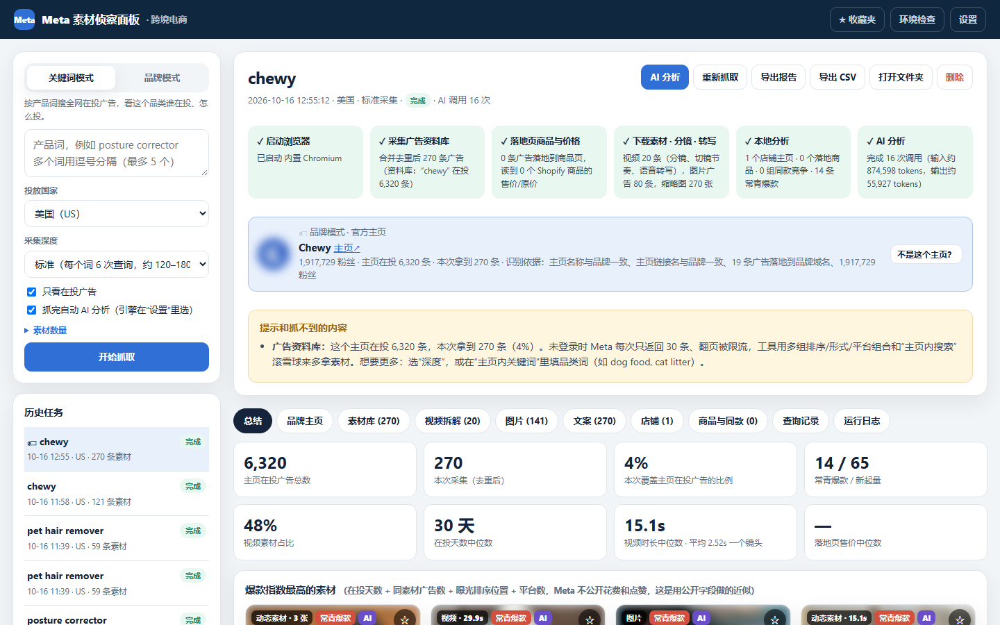
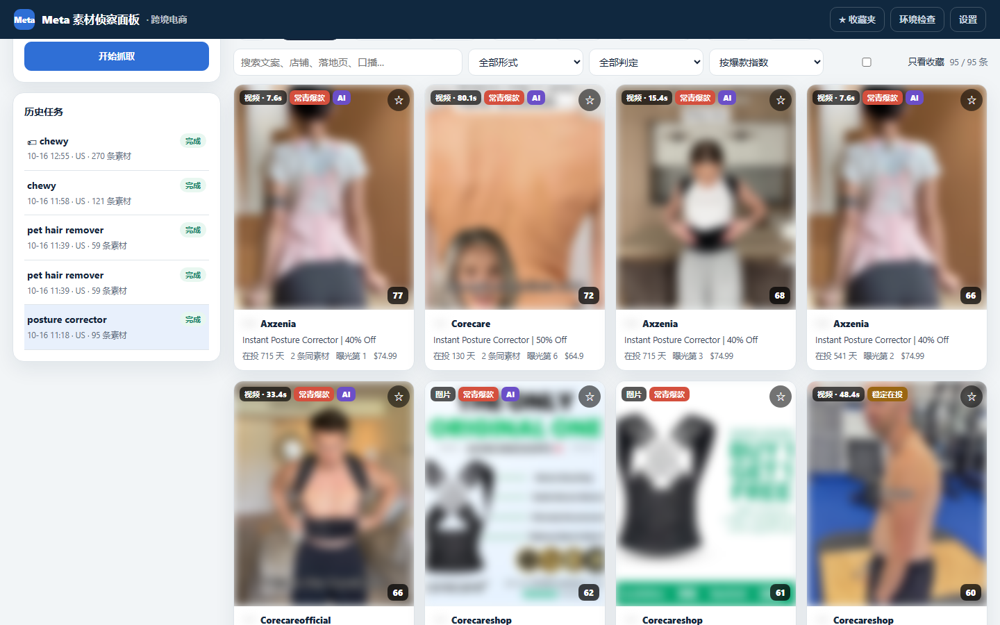
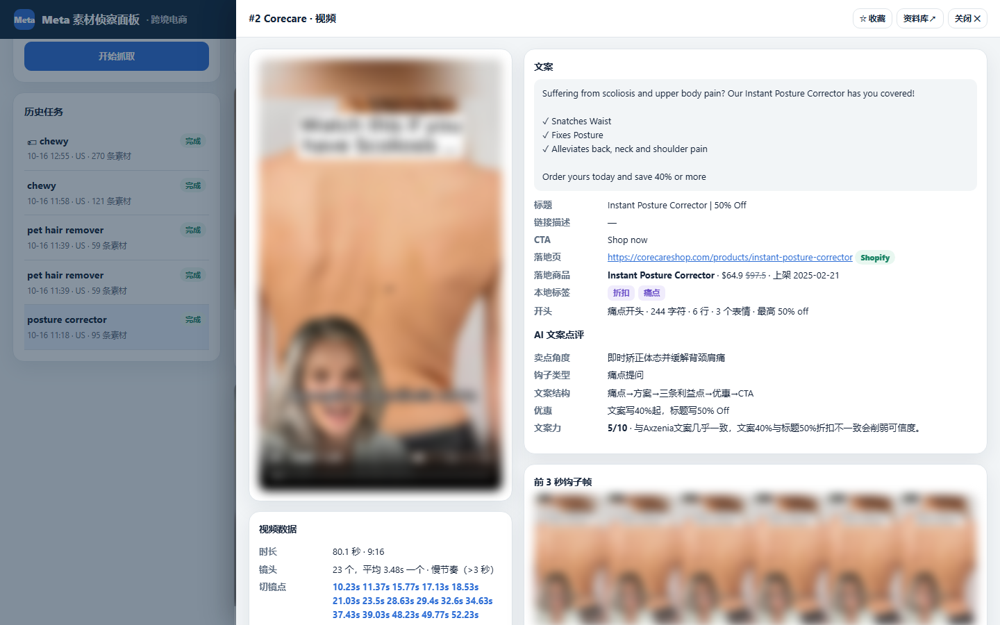
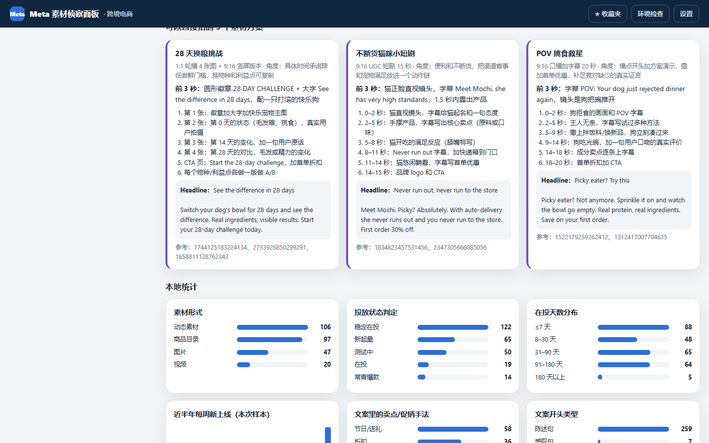
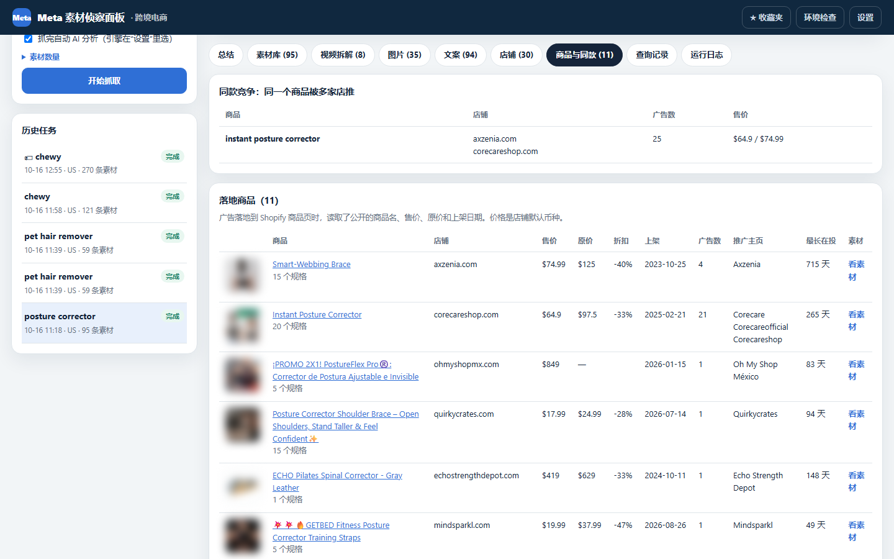

# Meta 素材侦察面板 · 跨境电商

输入**产品关键词**或**品牌名**，自动抓取 **Facebook 广告资料库**（Facebook / Instagram / Messenger / Audience Network）里正在投放的广告，把素材下载到本地、记录到面板，并对**图片、文案、视频**分别做分析。

免费、在你自己电脑上运行、不需要 Meta API。AI 分析可以用你自己的 Claude 订阅，不需要 API key。[English](README_EN.md) · 作者：图帕先生（[yestupa.com](https://yestupa.com)）

## 🚀 让 AI 帮你安装（推荐）

已经装好 [Claude Code](https://claude.com/claude-code) 或 Codex 的话，把下面这句话发给它就行：

```
帮我安装并启动这个工具：https://github.com/yestupa/meta-ads-local-spy
按仓库里 INSTALL.md 的步骤做。
```

AI 会自动下载代码、检查 Python、安装依赖和浏览器、启动面板，遇到报错也会帮你处理。以后要更新，对它说“帮我更新 meta-ads-local-spy”。
不用 AI 的话，按下面“一、准备”和“二、安装”手动操作，或者在 [Releases](https://github.com/yestupa/meta-ads-local-spy/releases) 下载压缩包。



**两种模式**

- **关键词模式**：输入 `posture corrector`，看这个品类谁在投、投了多久、主推什么卖点、落地页卖多少钱。
- **品牌模式**：输入 `chewy` 或 `chewy.com`，自动识别官方主页，只抓这个品牌的广告，拆解它的投放策略。

| 素材库 | 视频拆解 |
|---|---|
|  |  |
| **AI 洞察和素材方案** | **落地商品与同款竞争** |
|  |  |

<sub>截图中的广告素材画面已做模糊处理。</sub>

## 功能

| 能看到什么 | 说明 |
|---|---|
| 素材库 | 每条广告的视频/图片、主文案、标题、链接描述、CTA、落地页、上线日期、在投天数、“N 条广告使用了这个素材”、投放平台、店铺主页和粉丝数 |
| 爆款指数 | 0–100，用资料库公开字段做的近似：在投天数 + 同素材广告数 + 在“按曝光排序”列表里的位置 + 平台数 + 新起量加分。并判定 常青爆款 / 新起量 / 稳定在投 / 测试中 |
| 视频分析 | 时长、画幅、切镜点、镜头数和平均镜头时长（剪辑节奏）、前 3 秒钩子帧、逐秒分镜图、带时间戳的口播转写（点一行跳到那一秒播放） |
| 图片分析 | 主色（5 色）、画幅、明暗/饱和度、同一张图被多家店铺使用 |
| 文案分析 | 卖点/促销手法标签（折扣、包邮、买赠、限时、社会证明、无风险保障、痛点、专业背书、前后对比、节日、价格锚点）、开头类型、长度、表情数、高频词组（按使用的店铺数统计） |
| 店铺与商品 | 店铺排行；广告落地到 Shopify 商品页时，读取商品名、售价、原价、上架日期；**同款竞争**（同一个商品被几家店在推）、同一段文案被多个主页使用 |
| AI 分析 | 全部文案逐条点评（卖点角度、钩子类型、文案结构、优惠、1–10 分）；爆款指数前 N 条深度拆解（图片：OCR、画面、优缺点、可借鉴、改写；视频：逐镜头脚本、钩子、结构、节奏、改良脚本）；关键词总结 + **3 个可以直接拍的素材方案** |
| 收藏夹 | 在素材上点 ☆，收藏夹跨任务汇总 |
| 导出 | `报告.html`（离线可看，视频图片都在任务文件夹里）、`素材清单.csv`（Excel 直接打开） |

## 一、准备

1. **Windows 10/11 或 macOS**，**Python 3.10 或更高版本**（<https://www.python.org/downloads/>，安装时勾选 **Add python.exe to PATH**）。
2. **代理/VPN**：要能打开 facebook.com。资料库按面板里选的“投放国家”筛选广告，不需要把节点切到那个国家。
3. **AI 分析（二选一，可选）**：
   - **Claude Code（推荐，用 Claude Pro / Max 订阅，不需要 API key）**：安装 Claude Code（<https://claude.com/claude-code>），在终端运行 `claude`，输入 `/login` 登录一次。国内网络先给终端设置代理：
     ```powershell
     $env:HTTPS_PROXY = 'http://127.0.0.1:7890'
     $env:HTTP_PROXY = 'http://127.0.0.1:7890'
     claude
     ```
   - **Claude API**：在 <https://console.anthropic.com/> 申请 API key，填到面板的“设置”里，按用量付费。

   不配置 AI 也能抓取，本地的统计分析（爆款指数、文案标签、视频节奏、店铺/商品排行）照样有。

## 二、安装（只需一次）

- **Windows**：双击 `1-安装.bat`。
- **macOS**：打开“终端”，把 `mac-安装.command` 拖进窗口后回车。
- **命令行 / AI 助手**：在项目文件夹里运行 `python tools/setup.py`（全程不需要按键，最后会做环境检查）。

会在当前文件夹里创建独立的 Python 环境 `.venv`，安装抓取用的浏览器，并安装视频语音转写（faster-whisper，可选）。

## 三、使用

1. 双击 `2-启动面板.bat`（macOS 运行 `mac-启动面板.command`），浏览器会自动打开 <http://127.0.0.1:8766>。
2. 点右上角 **“环境检查”**，确认访问 Facebook、ffmpeg、AI 引擎都显示 ✓。
3. 在左侧输入**英文产品词**（例如 `posture corrector`、`pet hair remover`），多个词用逗号分隔（最多 5 个），选投放国家和采集深度，点 **“开始抓取”**。
4. 抓完后：
   - **总结**：资料库在投总数、爆款素材、各项统计图、AI 竞争格局和 3 个素材方案；
   - **素材库**：按形式、判定、爆款指数、在投天数、同素材数筛选和排序，点素材打开详情（视频播放、分镜、口播、文案、落地商品、AI 拆解）；没进前 N 的素材可以在详情里单独点“AI 拆解这条”；
   - **视频拆解 / 图片 / 文案 / 店铺 / 商品与同款 / 查询记录**：各个维度的列表；
   - **导出报告** / **导出 CSV**。

使用期间不要关闭黑色的命令行窗口。

## 四、两种模式

| | 关键词模式 | 品牌模式 |
|---|---|---|
| 输入 | 产品词，例如 `posture corrector`（可多个，逗号分隔） | 品牌名 / 官网域名 / Facebook 主页链接 / 主页 ID，例如 `chewy`、`chewy.com` |
| 抓什么 | 文案里出现这个词的所有广告主的广告，看一个品类谁在投 | 只抓这个品牌官方主页的广告，研究一个对标品牌 |
| 适合 | 选品、看品类竞争 | 拆解头部品牌的投放打法 |

品牌模式会先自动识别官方主页：按名称是否一致、主页链接、广告落地页是不是品牌域名、粉丝数打分。任务页顶部会显示识别到的主页和依据；认错了就打开“品牌主页”标签，在候选主页旁点“改抓这个主页”。

注意：关键词模式按“文案里有这个词”匹配，品牌名如果也是普通单词（例如 chewy = 有嚼劲的），会混进很多无关广告，这时用品牌模式。

## 五、采集深度和数量

未登录时，Meta 资料库每次打开只返回 30 条，滚动翻页的接口会返回 “Rate limit exceeded”。所以工具对每个关键词用多组查询（按曝光 / 按最新 × 全部 / 视频 / 图片 × 平台）分别打开，再合并去重：

| 深度 | 每个词的查询次数 | 大约能拿到 |
|---|---|---|
| 快速 | 2 | 60 条 |
| 标准 | 6 | 120–180 条 |
| 深度 | 10 | 200–300 条 |

想要更多，就多加几个相关关键词（例如 `posture corrector, back brace, posture support`）。每次查询的结果和链接都记在“查询记录”里。

品牌模式同样每次只能拿 30 条，所以先跑多组 排序 × 形式 × 平台 组合，再做“主页内搜索”：自动从已抓到的文案里挑高频词（dog、toys、halloween…）逐个在主页内搜索，直到没有新广告。也可以在“主页内关键词”里自己填品类词。

| 深度 | 查询次数 | 大约能拿到 |
|---|---|---|
| 快速 | 约 6 | 100–150 条 |
| 标准 | 约 18 | 250–400 条 |
| 深度 | 约 40 | 500–900 条 |

大品牌在投几千条广告（Chewy 有 6,000 多条），未登录拿不全，面板会显示本次覆盖了多少比例。

“素材数量”里可以调：下载并拆解多少条视频（默认 20）、下载多少条图片广告的全部图片（默认 80）、AI 深度拆解多少条（默认 12）。都按爆款指数从高到低处理。

## 六、常见问题

**提示“Meta 要求验证码”或跳到登录页**
在“设置”里勾选“抓取时显示浏览器窗口”，重试时手动完成验证；或者换一个代理节点，过一会儿再试。

**读不到商品价格**
只有落地到 Shopify 商品页（链接里有 `/products/`）的广告才能读到价格。独立站不是 Shopify、落地到首页/集合页，或店铺开了防护时读不到，表格里显示“—”。

**视频没有口播文字**
很多素材只有背景音乐。也可能没装 faster-whisper（环境检查里会显示），重新运行 `1-安装.bat` 即可。

**爆款指数准吗**
Meta 不公开美国广告的花费、曝光和点赞。爆款指数只用资料库公开的字段，适合用来排序、找线索，不等于真实的投放数据。“跑了很久 + 很多条同素材广告 + 在曝光排序里靠前”的素材，大概率是在赚钱的素材。

## 七、文件说明

```
1-安装.bat / 2-启动面板.bat / 3-打包分享.bat     Windows 一键脚本
mac-安装.command / mac-启动面板.command          macOS 脚本
INSTALL.md        给 Claude Code / Codex 等 AI 助手看的安装步骤
tools/setup.py    一条命令安装依赖并做环境检查（全程无需按键）
app/main.py       本地面板服务（只在本机 127.0.0.1:8766 上运行）
app/jobs.py       任务流程：采集 → 落地页商品 → 打分 → 素材下载与处理 → 本地分析 → AI 分析
app/meta.py       Meta 广告资料库：按关键词多组查询、合并去重
app/brand.py      品牌模式：识别官方主页、主页内多组查询和滚雪球搜索
app/shop.py       Shopify 落地页商品信息
app/media.py      素材下载、缩略图、主色、视频分镜、切镜节奏、语音转写
app/insights.py   本地分析：文案标签、爆款指数、店铺/商品排行、同款竞争、高频词
app/analyze.py    AI 分析（Claude Code 或 Claude API）
app/web/          面板页面
data/             运行后生成：设置和每个任务的数据、素材（不要分享）
```

## 八、授权

本项目源码公开、免费使用，但**不是**传统意义上的开源协议，完整条款见 [LICENSE](LICENSE)。简单说：

- ✅ 免费使用、修改，用于学习和你自己的业务；
- ✅ 可以免费分享给别人；
- ❌ 不能删除或修改软件里的作者署名和版权信息；
- ❌ 不能拿去收费（付费产品、付费课程、付费社群）。需要商用请联系作者。

## 九、注意事项

- 本工具只读取 Meta 广告资料库公开展示的广告信息和店铺公开的商品页，用于学习和研究竞品素材。下载的素材版权归原广告主所有，请勿直接盗用。
- 抓得太频繁可能被 Meta 暂时限制，建议每次间隔几分钟。
- Meta 改版后，解析规则可能需要更新（`app/meta.py`）。

## 关于作者

图帕先生制作

- 微信：yestupasemseo
- 网站：[yestupa.com](https://yestupa.com) · [yestupa.net](https://yestupa.net)
- 任何建议或反馈，可以发送到 [success@yestupa.com](mailto:success@yestupa.com)

觉得有用的话，欢迎点个 ⭐ Star，也欢迎在 Issues 里反馈问题和想要的功能。
